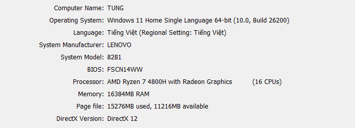
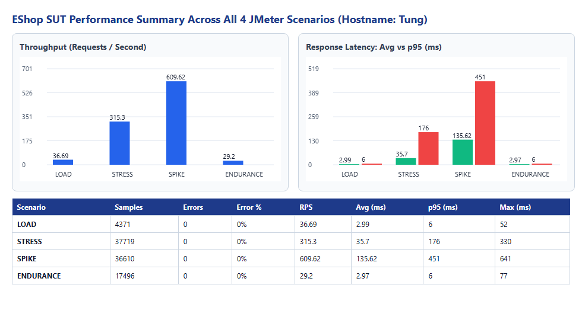
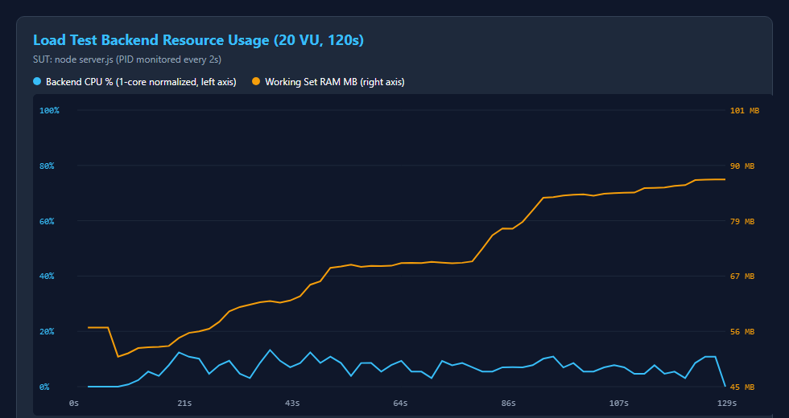
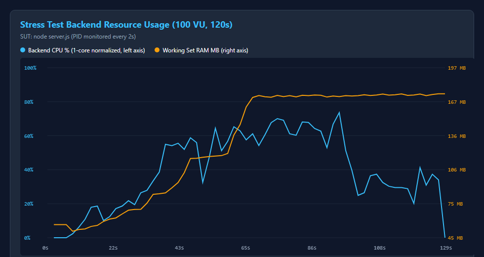
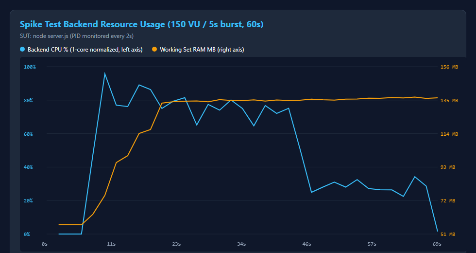
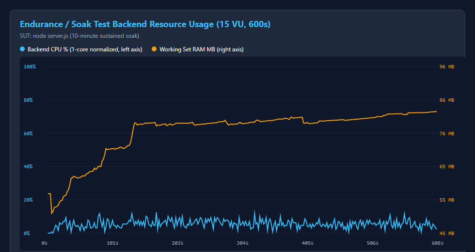
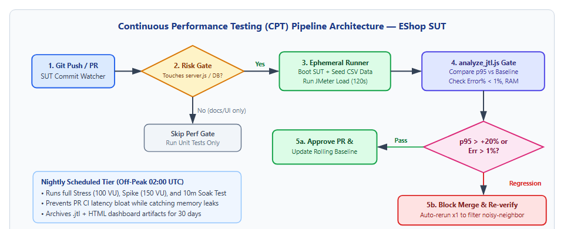
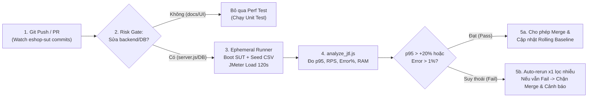

# Báo Cáo Kiểm Thử Hiệu Năng Hệ Thống EShop (HW05 — Performance Testing)

- **Sinh viên thực hiện:** `20120397` 
- **Môn học:** Kiểm thử Phần mềm — HW05 
- **Ngày thực nghiệm:** `2026-11-22`
- **Hệ thống kiểm thử (SUT):** `eshop-sut/backend`
- **Công cụ sử dụng:** Apache JMeter `5.6.3`, Node.js `v24.19.0`, OpenJDK `25.0.4.1`, PowerShell Resource Monitor, Antigravity Assistant (Gemini)
- **Kho lưu trữ GitHub:** `https://github.com/20120397/HW05-Performance_Testing-20120397.git`
- **Video Demo (Unlisted YouTube):**

---

## 1. Phạm Vi & Lựa Chọn Workflow Không Trùng Lặp

> **Workflow đã chọn:**  
> `Admin Login` ➔ `View Admin Orders` ➔ `View Admin Users` ➔ `View Categories` ➔ `Create Product` ➔ `Update Product` ➔ `Delete Product`

### Bảng Ánh Xạ 3 Nhóm Endpoint Bắt Buộc

| Nhóm Endpoint | Mã FR | API Cụ Thể | Vai Trò & Lý Do Bao Phủ Trong Workflow |
| :--- | :--- | :--- | :--- |
| **Auth-heavy** | `FR-02` | `POST /api/login` | Xác thực tài khoản quản trị viên (`admin@eshop.com`, `admin1..admin9@eshop.com`), ký JWT token (`jwt.sign`) và ghi DB khi reset/tăng `login_attempts`; có tính đến hành vi khóa tài khoản `locked_until`. |
| **Read-heavy** | `FR-18` | `GET /api/admin/orders` | Truy vấn danh sách đơn hàng kèm `LEFT JOIN users` (`orders.*, users.name`), xác thực JWT ở header `Authorization`. |
| **Read-heavy** | `FR-19` | `GET /api/admin/users` | Đọc toàn bộ danh sách tài khoản người dùng (`11` users sau khi seed, `~2,003 bytes` payload/response). |
| **Read-heavy** | `FR-14` | `GET /api/categories` | Truy vấn danh mục sản phẩm hiển thị trên form tạo/sửa sản phẩm (`Điện thoại`, `Laptop`, `Phụ kiện`). |
| **Transactional** | `FR-15` | `POST /api/products` | Ghi mới sản phẩm vào bảng `products` từ CSV `products_payload.csv` và trích xuất `created_product_id` (`$.id`). |
| **Transactional** | `FR-15` | `PUT /api/products/${created_product_id}` | Cập nhật tên và giá sản phẩm vừa tạo ngay trong cùng vòng lặp của Virtual User. |
| **Transactional** | `FR-15` | `DELETE /api/products/${created_product_id}` | Xóa bản ghi vừa tạo để giữ kích thước bảng `products` sạch và không làm phình dung lượng DB trong bài Soak 10 phút. |

---

## 2. Báo Cáo Phần Cứng & Môi Trường Thực Nghiệm


| Thành Phần | Thông Số Thực Tế |
| :--- | :--- |
| **Hostname** | **`Tung`** |
| **Hệ điều hành (OS)** | Windows 11 Home Single Language (`10.0.26200`, `x64`) |
| **Vi xử lý (CPU)** | AMD Ryzen 7 4800H with Radeon Graphics (`16 Logical CPUs`, Base Clock `2894 MHz`) |
| **Bộ nhớ RAM** | `15.87 GB` vật lý (khả dụng lúc khởi chạy: `~6.95–7.00 GB`) |
| **Runtime SUT** | Node.js `v24.19.0`, Express + `sqlite3` (`D:\KTPM\eshop-sut\backend\server.js`, cổng `3000`) |
| **JMeter & Java** | Apache JMeter `5.6.3` trên OpenJDK `25.0.4.1 LTS` (`-Xms1g -Xmx1g`) |



---

## 3. Task 1 — Thiết Kế, Phản Biện Con Người & Thực Thi Kiểm Thử Hiệu Năng

### 3.1. Thiết Kế Test Plan Theo Từng Bước Với AI (Data-Driven & 3 Report Views)

Bốn kịch bản kiểm thử sử dụng chung một luồng nghiệp vụ 7 bước với **2 tệp CSV tham số hóa**:
1. `data/admin_credentials.csv`: `10` tài khoản Admin (`admin@eshop.com` và `admin1@eshop.com`..`admin9@eshop.com`, mật khẩu `Admin123!`).
2. `data/products_payload.csv`: `20` bộ dữ liệu sản phẩm tiếng Việt (`name`, `price`, `description`, `imageUrl`, `category_id`, `updated_name`, `updated_price`).

| Kịch Bản | Tên File `.jmx` | Virtual Users | Ramp-Up | Duration | Gaussian Think Time | Loại Report View (Không Trùng Lặp) |
| :--- | :--- | :---: | :---: | :---: | :---: | :--- |
| **Load** | `20120397_Load_20261122.jmx` | `20` | `20s` | `120s` | `500 ms ± 200 ms` | **1. Summary Report** (`SummaryReport`) |
| **Stress** | `20120397_Stress_20261122.jmx` | `100` | `60s` | `120s` | `200 ms ± 100 ms` | **2. Aggregate Report** (`StatVisualizer`) |
| **Spike** | `20120397_Spike_20261122.jmx` | `150` | `5s` (bùng nổ) | `60s` | `100 ms ± 50 ms` | **3. View Results Tree** (`ViewResultsFullVisualizer`) |
| **Endurance (Soak)** | `20120397_Endurance_20261122.jmx` | `15` | `15s` | `600s` (10 phút) | `500 ms ± 200 ms` | **Response Time Graph** (`RespTimeGraphVisualizer`) |

### 3.2. Phản Biện & Sửa Lỗi Test Plan Của AI (Human Review & Fixes)

| STT | Sai Sót / Thiếu Sót Của AI Ở Bản Nháp | Nguyên Nhân AI Bỏ Sót | Cách Con Người Đã Khắc Phục |
| :---: | :--- | :--- | :--- |
| **1** | Chỉ dùng duy nhất 1 tài khoản `admin@eshop.com` cho 100–150 luồng đồng thời | AI không xét rủi ro khóa tài khoản hàng loạt và tranh chấp ghi hàng `users` (`UPDATE users SET login_attempts = 0`) | Tạo CSV `admin_credentials.csv` gồm `10` tài khoản Admin và viết `scripts/seed-sut.js` đăng ký/nâng quyền `admin1..admin9` qua REST API ngay khi khởi động server. |
| **2** | Bỏ qua việc seed đơn hàng trước khi chạy `GET /api/admin/orders` | AI giả định DB đã có sẵn dữ liệu đơn hàng; thực tế `database.js` chỉ seed `categories`, `users`, `products`, `coupons` | Bổ sung vào `scripts/seed-sut.js` bước đăng nhập `test@eshop.com` tạo `5` đơn hàng thật để `GET /api/admin/orders` thực thi đúng câu truy vấn `LEFT JOIN users`. |
| **3** | Assertion yếu: chỉ kiểm tra `Response Code == 200` | AI mặc định `200 OK` đồng nghĩa nghiệp vụ đúng, không đọc `server.js:179-196` | Phát hiện `PUT/DELETE /api/products/999999` vẫn trả `200 OK`; bổ sung `ResponseAssertion` kiểm tra chuỗi JSON phản hồi (`"token"`, `"Product created"`, `"Product updated"`, `"Product deleted"`). |
| **4** | Không tính đến lỗi `login_attempts + 2` khi reset lockout | Prompt ban đầu không đính kèm logic `server.js:54` | Kiểm chứng thực tế (`verify-lockout-and-bugs.js`) thấy hệ thống khóa sau **2 lần sai** (`BUG-AUTH-01`), từ đó xây dựng quy trình reset sạch giữa các lần chạy. |
| **5** | Dùng cấu hình Log4j2 mặc định của JMeter khi chạy CLI không giao diện | Giới hạn môi trường Windows headless/sandbox chặn ghi Registry `GuiPackage` | Tạo `scripts/log4j2-cli.xml` loại bỏ `GuiLogEvent` và cấu hình `run-scenario.ps1` chạy ổn định trong non-GUI mode. |

### 3.3. Quy Trình Reset Account Lockout Giữa Các Lượt Chạy

Khi kiểm thử `POST /api/login` (`FR-02`), hàm xử lý tại `server.js:54-62` cộng `login_attempts + 2` và khóa tài khoản trong `180,000 ms` (3 phút) ngay khi `newAttempts >= 3`. Để bảo đảm tính lặp lại giữa các lượt chạy Load, Stress, Spike và Endurance:
1. **Cách 1 (Được tự động hóa trong `scripts/run-scenario.ps1`):** Dừng tiến trình `node server.js` của lượt trước và khởi động lại `node server.js` mới. Hàm `initDatabase()` trong `database.js` tự động chạy `DROP TABLE` / `CREATE TABLE` và seed lại trạng thái `login_attempts = 0, locked_until = NULL`, sau đó `scripts/seed-sut.js` tạo lại 9 tài khoản admin phụ và 5 đơn hàng.
2. **Cách 2 (Reset nóng trực tiếp trên SQLite giữa 2 lần bấm GUI):** Thực thi truy vấn SQL trực tiếp vào `D:\KTPM\eshop-sut\backend\database.sqlite`:
   ```sql
   UPDATE users SET login_attempts = 0, locked_until = NULL;
   ```
   (Hoặc đợi hết 180 giây để điều kiện `new Date() < new Date(user.locked_until)` hết hiệu lực).

### 3.4. Kết Quả Thực Thi 3 Kịch Bản Chính (Load, Stress, Spike)

| Chỉ Số Tổng Hợp | Load Test (`20 VU / 120s`) | Stress Test (`100 VU / 120s`) | Spike Test (`150 VU / 5s / 60s`) |
| :--- | :---: | :---: | :---: |
| **Raw `.jtl` Log** | `20120397_Load_20261122.jtl` | `20120397_Stress_20261122.jtl` | `20120397_Spike_20261122.jtl` |
| **Total Samples** | `4,371` | `37,719` | `36,610` |
| **Errors / Error %** | `0` (`0.00%`) | `0` (`0.00%`) | `0` (`0.00%`) |
| **Throughput (RPS)** | **`36.69 RPS`** | **`315.30 RPS`** (đỉnh `481.97 RPS`) | **`609.62 RPS`** (đỉnh `788.27 RPS`) |
| **Avg Latency** | `2.99 ms` | `35.70 ms` | `135.62 ms` |
| **p50 / p90 / p95 / p99** | `3 / 5 / 6 / 9 ms` | `7 / 133 / 176 / 237 ms` | `80 / 395 / 451 / 517 ms` |
| **Max Latency** | `52 ms` | `330 ms` | `641 ms` |
| **Backend CPU (1-Core Avg / Max)** | `6.71%` / `13.25%` | `39.72%` / `73.63%` | `50.88%` / **`95.73%`** |
| **Backend CPU (All 16 Cores Max)** | `0.83%` | `4.60%` | `5.98%` |
| **Working Set RAM (Start ➔ Max)** | `56.98` ➔ `86.96 MB` | `56.75` ➔ **`173.64 MB`** | `56.78` ➔ `136.93 MB` |
| **Private Memory Peak** | `101.52 MB` | **`209.59 MB`** | `160.31 MB` |

#### Chi Tiết Theo Từng Endpoint Trong Kịch Bản Load (`20 VU`) & Stress (`100 VU`)

| Endpoint | Load Samples | Load Avg / p95 (ms) | Stress Samples | Stress Avg / p95 / Max (ms) | Spike Avg / p95 / Max (ms) |
| :--- | :---: | :---: | :---: | :---: | :---: |
| `01_POST_Admin_Login` | `634` | `2.28 / 4` | `5,430` | `35.11 / 176 / 330` | `136.77 / 457 / 641` |
| `02_GET_Admin_Orders` | `630` | `2.00 / 4` | `5,413` | `33.31 / 167 / 314` | `133.08 / 446 / 641` |
| `03_GET_Admin_Users` | `626` | `1.98 / 3` | `5,405` | `32.95 / 160 / 318` | `133.88 / 446 / 623` |
| `04_GET_Categories` | `624` | `1.62 / 3` | `5,390` | `32.90 / 163 / 329` | `133.37 / 445 / 611` |
| `05_POST_Create_Product` | `622` | `4.39 / 7` | `5,377` | `37.98 / 178.2 / 329` | `136.88 / 457.85 / 625` |
| `06_PUT_Update_Product` | `618` | `4.34 / 7` | `5,360` | `39.08 / 190 / 327` | `137.70 / 455.8 / 613` |
| `07_DELETE_Delete_Product` | `617` | `4.37 / 7` | `5,344` | `38.63 / 185 / 317` | `137.72 / 452.65 / 633` |



#### Biểu Đồ Tài Nguyên Backend (`node.exe`) Cho Load, Stress, Spike





> **Phát hiện quan trọng ở Stress & Spike:**  
> - Ở **Stress (`100 VU`)**, hệ thống tăng tốc đều từ `123.10 RPS` (`0–30s`) lên `352.43 RPS` (`30–60s`) và đạt đỉnh **`481.97 RPS`** (`60–90s`, `p95 = 13 ms`), nhưng đến cửa sổ **`90–120s`** đã xuất hiện điểm gãy (**latency cliff**): thông lượng tụt **37.8%** xuống còn **`299.80 RPS`** trong khi `Avg` vọt gấp **25x** (`5.05 -> 127.95 ms`) và **`p95` tăng 17.7x lên `231 ms`**.  
> - Ở **Spike (`150 VU / 5s`)**, `0–30s` xử lý được **`788.27 RPS`** (`p95 = 120 ms`), nhưng sang **`30–60s`** tiến trình `node.exe` bão hòa **`95.73%` CPU đơn nhân**, kéo thông lượng rơi **45.2%** xuống `432.07 RPS` và **`p95` vọt lên `499 ms`**.

### 3.5. Thử Nghiệm Độ Bền 10 Phút (Endurance / Soak Test) & Xác Định Ngưỡng Chịu Đựng Phần Cứng

Kịch bản Endurance (`20120397_Endurance_20261122.jmx`) chạy liên tục **600 giây (10 phút)** ở mức tải bền vững `15 VU`:
- **Tổng số mẫu:** `17,496` samples trong `599.09s`, **`0` lỗi (`0.00%`)**, thông lượng duy trì ổn định ở **`29.20 RPS`**.
- **Độ ổn định độ trễ theo cửa sổ 30 giây:** Sau pha khởi động `0–30s` (`Avg = 5.67 ms`, `p95 = 13 ms`), từ giây `30s` đến hết `600s` (19 cửa sổ liên tiếp), `Avg` dao động cực kỳ ổn định trong khoảng **`2.41–3.18 ms`** và **`p95` giữ nguyên `5–7 ms`**, không hề có xu hướng phình độ trễ theo thời gian.
- **Tài nguyên phần cứng trong 10 phút (`302` mẫu đo):** CPU 1-core trung bình **`5.51%`** (đỉnh `12.46%`), Working Set RAM khởi điểm `57.04 MB` và cân bằng quanh **`82.20 MB`** (`Private Memory Max = 103.05 MB`), `16` threads và `229` handles — **không có rò rỉ bộ nhớ (memory leak)**.



#### Kết Luận Ngưỡng Chịu Đựng Phần Cứng (AMD Ryzen 7 4800H / 16 GB RAM)
- **Ngưỡng vận hành bền vững dài hạn đã kiểm chứng (Soak-verified safe baseline):** **`29.20 – 36.69 RPS`** (`15–20 VU`), `p95 <= 6 ms`, CPU 1-core `< 14%`, RAM `<= 87 MB`, ổn định tuyệt đối qua 10 phút.
- **Ngưỡng chịu tải tối đa trước khi suy giảm (Max Stable RPS Ceiling):** Khoảng **`350 – 400 RPS`** (tương ứng `~60–75 VU` với think time thực tế `200–500 ms`), giữ `p95 < 50 ms` và CPU 1-core `< 60%`.
- **Điểm bão hòa / Vượt ngưỡng (Breaking Point & Memory Ceiling):** Đỉnh tức thời đạt `481.97 RPS` (Stress) và `788.27 RPS` (Spike) nhưng không thể duy trì quá 30–90 giây; tại `100–150 VU`, CPU đơn nhân chạm trần **`95.73%`**, `p95` vọt lên **`231 – 499 ms`**, và RAM của riêng tiến trình Node.js tăng gấp `3–3.7x` lên **`173.64 MB` Working Set (`209.59 MB` Private)**.

---

## 4. Task 2 — Phân Tích Log Bằng AI & Truy Tìm Lỗi Diễn Giải (Misinterpretation Hunt)

### 4.1. Ngưỡng Đề Xuất & Nhận Định Ban Đầu Của AI

Khi cung cấp các thông số tóm tắt ban đầu (Load, Stress, Spike và CPU tổng `4.60%–5.98%`) cho AI, AI đưa ra phân tích và đề xuất ngưỡng cảnh báo (`Avg < 100 ms`, `p95 < 200 ms`, `Error < 1%`), đồng thời kết luận hệ thống xử lý tốt 100 VU nhờ `p50 = 7 ms` và CPU còn rất rảnh (`< 6%`), rồi đề xuất 6 biện pháp tối ưu hóa.

### 4.2. Bảng Truy Tìm Lỗi Diễn Giải Số Liệu (Misinterpretation Hunt)

| STT | Nhận Định Sai / Lệch Của AI | Giá Trị Đúng Từ Raw `.jtl` / Resource Log | Giải Thích Nguyên Nhân Sai Lệch |
| :---: | :--- | :--- | :--- |
| **1** | *"Stress Test (`100 VU`) vẫn phản hồi rất nhanh với trung vị `p50 = 7 ms`, chưa có dấu hiệu nghẽn."* | Trong `20120397_Stress_20261122.jtl`, dù `p50 = 7 ms`, nhưng **`p95 = 176 ms`**, **`p99 = 237 ms`**. Đặc biệt tại cửa sổ **`90–120s`**, `RPS` tụt từ `481.97` xuống `299.80`, `Avg` vọt lên `127.95 ms` và **`p95 = 231 ms`** (`Max = 330 ms`). | AI dùng trung vị (`p50`) và trung bình cộng gộp toàn phiên để đánh giá hiệu năng, bỏ qua đuôi phân phối (`p95`/`p99`) và xu hướng suy thoái theo chuỗi thời gian. |
| **2** | *"CPU tối đa chỉ `4.60%` (Stress) và `5.98%` (Spike) chứng tỏ máy còn dư hơn 94% năng lực xử lý."* | File `resource-usage-spike.csv` cho thấy `node.exe` đạt **`95.73%` CPU đơn nhân** (`1-core normalized`) ở Spike và **`73.63%`** ở Stress (`cpu1CoreMaxPct`). | AI đọc nhầm chỉ số % chia đều trên cả **16 luồng logic** (`5.98% × 16 ≈ 95.68%`), quên rằng Express/Node.js chạy đơn luồng nên chỉ dùng tối đa ~1 nhân CPU! |
| **3** | *"Ở Spike Test (`150 VU`), `Avg = 135.62 ms` là độ trễ ổn định trung bình khi chịu tải đột biến."* | Raw `20120397_Spike_20261122.jtl`: cửa sổ `0–30s` đạt `788.27 RPS` (`Avg = 75.29 ms`, `p95 = 120 ms`), nhưng `30–60s` tụt 45.2% còn `432.07 RPS` (`Avg = 245.68 ms`, **`p95 = 499 ms`**, `Max = 641 ms`). | Hiện tượng **Simpson's Paradox** trên chuỗi thời gian: lấy trung bình gộp che khuất hoàn toàn việc hiệu năng nửa sau của Spike tệ hơn gấp `3.2x`–`4.1x` nửa đầu. |
| **4** | *"Cần điều tra tỷ lệ lỗi `500` / `SQLITE_BUSY` khoảng 1–2% phát sinh trong Stress và Spike."* | Cả 4 raw `.jtl` (`4,371 + 37,719 + 36,610 + 17,496 = 96,196` samples) đều ghi nhận **`0` errors (`0.00%`)**, `100%` phản hồi HTTP `200`. | AI tự suy diễn (hallucinate) lỗi `SQLITE_BUSY` phổ biến trên SQLite thay vì kiểm tra cột `success` và `responseCode` trong log thực tế (do `sqlite3` Node binding xếp hàng tuần tự trong bộ nhớ thay vì ném lỗi ngay khi timeout chưa vượt ngưỡng). |
| **5** | *"Thao tác `POST /api/products` chậm hơn `GET /api/admin/orders` gấp 10 lần nên là nút thắt duy nhất."* | Trong Load (`20 VU`): `POST /api/products` `Avg = 4.39 ms` (`p95 = 7 ms`) so với `GET /api/admin/orders` `Avg = 2.00 ms` (`p95 = 4 ms`) — chỉ chậm hơn **~2.2 lần**. Trong Spike (`150 VU`), mọi GET và POST đều vọt lên `133–138 ms` (`p95 = 445–458 ms`). | AI phóng đại chi phí ghi SQLite trong kịch bản tải thấp và không nhận ra dưới tải Spike, nút thắt chủ yếu là xếp hàng trên Event Loop CPU (`95.73%`) ảnh hưởng đồng đều tới cả `GET` lẫn `POST`. |

### 4.3. Đánh Giá Tính Khả Thi Của Các Đề Xuất Tối Ưu Hóa (Feasible vs Hallucinated)

| STT | Đề Xuất Tối Ưu Hóa Của AI | Phân Loại | Lý Giải Dựa Trên Mã Nguồn Thực Tế |
| :---: | :--- | :---: | :--- |
| **1** | **Bật SQLite WAL mode** (`PRAGMA journal_mode = WAL;`) | **Feasible (Khả thi)** | `database.js` dùng `sqlite3` mặc định (`DELETE` journal mode), khiến thao tác đọc (`GET /api/admin/orders`, `/users`) bị chặn khi có thao tác ghi (`POST/PUT/DELETE /api/products`). Bật WAL cho phép đọc và ghi song song trực tiếp trên `database.sqlite`. |
| **2** | **Thêm Index DB cho `users(email)` và `orders(user_id)`** | **Feasible (Khả thi)** | `database.js` tạo bảng `users` và `orders` không có `INDEX` trên `email` hay `user_id`. Mỗi lượt `POST /api/login` (`WHERE email = ?`) hiện phải quét toàn bảng (`Full Table Scan`), càng chậm khi bảng `users` phình to. |
| **3** | **Chạy đa tiến trình Node.js Cluster / PM2 Cluster** | **Feasible có điều kiện (Conditional)** | Khắc phục trực tiếp nút thắt `95.73%` CPU đơn nhân ở Spike Test bằng cách tận dụng `16` luồng CPU. **Tuy nhiên**, `server.js:14` lưu giỏ hàng trong RAM cục bộ (`const userCarts = {}`), nên nếu chạy cluster cần chuyển `userCarts` vào SQLite/Redis trước để tránh mất giỏ hàng giữa các worker. |
| **4** | **Thêm Connection Pool (`max: 50`, kiểu PgBouncer/mysql2 pool)** | **Hallucinated (Ảo)** | SUT sử dụng **`sqlite3` nhúng trong cùng tiến trình** đọc/ghi trực tiếp tệp cục bộ `database.sqlite`, không phải hệ quản trị CSDL client-server qua TCP như PostgreSQL/MySQL. Mở 50 kết nối ghi song song vào một tệp SQLite thực chất làm **tăng** tranh chấp khóa `SQLITE_BUSY`. |
| **5** | **Giảm `bcrypt` salt rounds từ `12` xuống `8` trong `POST /api/login`** | **Hallucinated (Ảo)** | Kiểm tra trực tiếp `server.js:46` cho thấy hệ thống so sánh mật khẩu trực tiếp bằng văn bản thuần (`if (user.password === password)`), **không hề cài đặt hay dùng `bcrypt`**! Do đó `POST /api/login` chỉ tốn `2.02–2.28 ms` ở tải thấp chứ không phải điểm nghẽn hashing. |
| **6** | **Dựng cụm Redis Cache cho `GET /api/categories`** | **Hallucinated / Over-engineered** | `GET /api/categories` chỉ trả về `3` dòng dữ liệu tĩnh (`358 bytes`) trong `1.61–1.62 ms` ở Load/Endurance. Việc dựng thêm Redis Cluster qua mạng nội bộ vừa thừa độ phức tạp hạ tầng vừa không giải quyết được nút thắt CPU Event Loop ở Spike/Stress. |

---

## 5. Task 3 — Đề Xuất Mô Hình Continuous Performance Testing (Bloom-AI G9.6 Disrupt)

### 5.1. Kiến Trúc Pipeline Theo Dõi Commit & Phát Hiện Suy Thoái `p95`

Để ngăn chặn suy thoái hiệu năng lọt vào nhánh chính của `eshop-sut`, mô hình **Continuous Performance Testing (CPT) Hai Tầng** được đề xuất như sau:

1. **Tầng 1 — PR Commit Watcher & Risk Gate (Tự động theo mỗi Commit/PR):**
   - Khi có commit mới đẩy lên nhánh PR, CI watcher kiểm tra `git diff`. Nếu commit **chỉ sửa tài liệu hoặc CSS/UI** không ảnh hưởng API, bước chạy Load Test được bỏ qua để tiết kiệm tài nguyên.
   - Nếu commit đụng tới `backend/server.js`, `database.js`, hoặc `package.json`, CI tự động dựng môi trường cô lập (ephemeral container/runner), khởi chạy SUT + seed CSV và chạy **Gate Load Test (`20 VU / 120s`)**.
   - Script `Agent-Skill/scripts/analyze_jtl.js` trích xuất `p95` và `Error %` từ raw `.jtl`, đối chiếu với **Rolling Baseline** (trung bình trượt của 5 bản build xanh gần nhất).
   - **Quy tắc gắn cờ suy thoái (Regression Gate):** Chặn merge nếu `p95` tăng **`> +20%`** (ví dụ vượt quá ngưỡng `~8–10 ms` ở Load 20 VU) hoặc `Error % > 1%`. Nếu bị flag ở lần chạy đầu, runner tự động **chạy lại 1 lần xác minh (`Auto-rerun x1`)** để loại trừ nhiễu CPU tạm thời trên runner dùng chung trước khi báo động đỏ.
2. **Tầng 2 — Nightly Heavy Tier (02:00 UTC hàng đêm):**
   - Chạy định kỳ Stress (`100 VU`), Spike (`150 VU`) và Soak Test (`10–15 phút`) ngoài giờ làm việc, lưu trữ `.jtl` và HTML dashboard 30 ngày để phát hiện rò rỉ bộ nhớ dài hạn mà không làm chậm tốc độ merge PR ban ngày.





### 5.2. Phân Tích Đánh Đổi (Trade-Off Analysis)

| Khía Cạnh | Lợi Ích Đạt Được | Chi Phí / Rủi Ro & Cách Giảm Thiểu |
| :--- | :--- | :--- |
| **Chi phí hạ tầng & Thời gian CI (Cost & Latency)** | Phát hiện sớm suy thoái API ngay tại thời điểm tạo PR trước khi lên production. | Chạy JMeter Stress/Endurance trên mỗi commit tốn ~15 phút runner. **Giảm thiểu:** Chỉ chạy Load Test gọn 2 phút trên PR có đụng code backend (`Risk Gate`), đẩy Stress/Spike/Soak 10 phút sang **Nightly Schedule**. |
| **Báo động giả (False Alarms / Noisy Neighbor)** | Ngưỡng `p95 +20%` nhạy với các thay đổi làm chậm truy vấn SQL hoặc khóa đồng bộ. | Máy ảo CI dùng chung thường có nhiễu CPU (`jitter`) làm `p95` biến động ảo từ `6 ms` lên `9–10 ms`. **Giảm thiểu:** Dùng ngưỡng tương đối kết hợp sàn tuyệt đối (`delta p95 > max(20%, +15 ms)`), chỉ chạy trên dedicated/pinned runner, và tự động **re-run 1 lần** trước khi chặn PR. |
| **Trượt chuẩn nền (Baseline Drift)** | Cập nhật tự động Rolling Baseline giúp phản ánh đúng sự mở rộng dữ liệu thực tế. | Nếu các PR tăng nhẹ `5%` liên tiếp mỗi tuần, tổng suy thoái sau 1 tháng có thể vượt `30%` mà không kích hoạt ngưỡng `+20%`. **Giảm thiểu:** So sánh song song cả với **Rolling Baseline (5 PR gần nhất)** lẫn **Static Anchor Baseline (v1.0)** mỗi tuần. |

---

## 6. Phê Bình AI (AI Critique — 273 Từ, Mục 10)

Trong quá trình kiểm thử hiệu năng hệ thống EShop, AI hỗ trợ nhanh việc dựng bốn kịch bản JMeter, tạo dữ liệu CSV và viết script phân tích log, nhưng vẫn mắc nhiều sai sót ở cả khâu thiết kế lẫn diễn giải kết quả. Khi tạo test plan, AI mặc định dùng một tài khoản admin, bỏ qua lỗi `login_attempts + 2` làm khóa tài khoản sau hai lần sai, và chỉ kiểm tra mã HTTP 200 nên bỏ lọt lỗi cập nhật hoặc xóa ID không tồn tại vẫn trả về thành công giả. Lúc phân tích kết quả, AI nhìn trung vị `p50 = 7 ms` ở Stress Test mà kết luận hệ thống còn dư tải, bỏ sót cú sụp đổ thông lượng xuống 299.80 RPS và độ trễ `p95 = 231 ms` tại cửa sổ 90–120 giây; đồng thời hiểu nhầm CPU tổng 5.98% trên 16 luồng là nhẹ trong khi tiến trình `node.exe` đã bão hòa 95.73% trên một nhân ở Spike Test. Nghiêm trọng hơn, AI bịa đặt đề xuất dựng connection pool kiểu PgBouncer, giảm `bcrypt` rounds và thêm Redis Cluster cho `/api/categories`, dù mã nguồn chỉ dùng SQLite nhúng và so sánh mật khẩu dạng văn bản thuần. Nguyên nhân là AI suy đoán theo khuôn mẫu phổ biến thay vì kiểm tra mã nguồn `server.js`, `database.js` và chuỗi thời gian trong file `.jtl` thô. Nguyên tắc tôi rút ra là: AI chỉ giúp khởi tạo nhanh, còn mọi số liệu và khuyến nghị tối ưu đều phải được con người đối chiếu trực tiếp với dữ liệu gốc và mã nguồn thật.

---

## 7. Tài Liệu Tham Khảo (Mục 16)

1. ISTQB Foundation Level Syllabus (latest edition) — Performance Testing Types & Metrics.
2. Hardman, P. (2025). *A Post-AI Learning Taxonomy* (Bloom-AI G9.2, G9.3, G9.4, G9.6).
3. Fuster Rabella, M. (2025). *OECD Education Working Paper No. 338*.
4. Anthropic (2025). *Building Reliable AI Test Agents* — engineering blog.
5. DeepEval & Promptfoo documentation — LLM testing frameworks.
6. Tài liệu đặc tả EShop SUT (`eshop-sut/README.md`, `eshop-sut/api_specification.md`, `eshop-sut/backend/server.js`, `eshop-sut/backend/database.js`).
