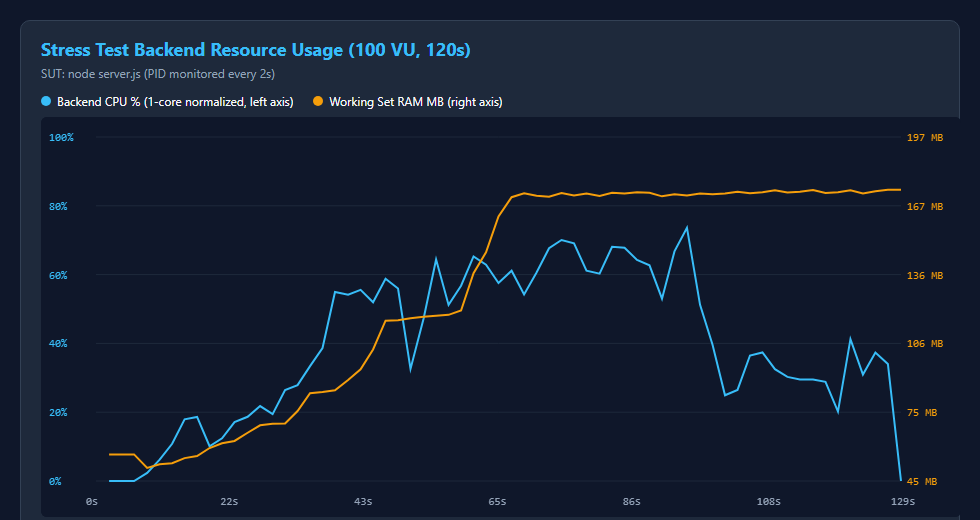
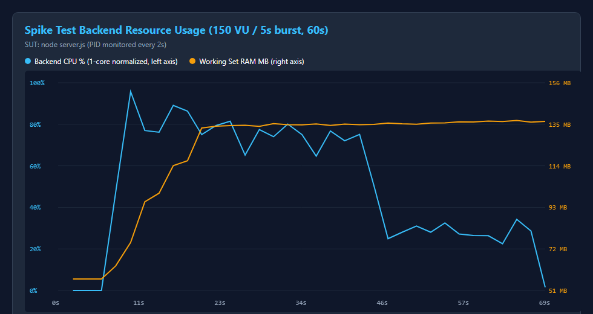

# Báo Cáo Lỗi Chức Năng, Bảo Mật & Hiệu Năng (Bug & Performance Issue Report)

> **Hệ thống kiểm thử:** `eshop-sut/backend` (`http://localhost:3000`)  
> **Sinh viên thực hiện:** `20120397` (`quangtung1112002@gmail.com`)  
> **Kho lưu trữ bài làm:** `https://github.com/20120397/HW05-Performance_Testing-20120397.git`  
> **Bằng chứng xác thực thô:** [functional-and-lockout-verification.json](../evidence/functional-and-lockout-verification.json) & [ground-truth-metrics.json](../evidence/ground-truth-metrics.json)

---

## Tổng Hợp Danh Sách Vấn Đề Phát Hiện

| Mã Lỗi | Loại | Mức Độ (Severity) | Endpoint / Vị Trí Mã Nguồn | Tóm Tắt Vấn Đề |
| :--- | :--- | :--- | :--- | :--- |
| **BUG-PERF-01** | Performance | **High** | `POST/PUT/DELETE /api/products` & `server.js` + `database.js` | Sụp đổ thông lượng & vọt độ trễ `p95` gấp **17.7x** (`13 ms -> 231 ms`) tại cửa sổ `90–120s` trong Stress Test (`100 VU`) |
| **BUG-PERF-02** | Performance | **High** | Node.js Single-Thread Event Loop (`server.js`) | Bão hòa CPU đơn luồng lên **95.73%** trong Spike Test (`150 VU / 5s`), khiến RPS giảm **45.2%** (`788.27 -> 432.07 RPS`) và `p95` đạt **499 ms** |
| **BUG-AUTH-01** | Functional / Auth | **High** | `POST /api/login` (`server.js:54-58`) | Cộng dồn `login_attempts + 2` làm khóa tài khoản ngay sau **2 lần sai** thay vì 3 lần như đặc tả |
| **BUG-SEC-01** | Security | **Critical** | `POST/PUT/DELETE /api/products` (`server.js:167-196`) | Thiếu middleware `authenticateToken`, cho phép người dùng ẩn danh thêm/sửa/xóa sản phẩm trả về `200 OK` |
| **BUG-SEC-02** | Security (RBAC) | **Critical** | `GET /api/admin/users`, `GET /api/admin/orders` (`server.js:494, 510`) | Chỉ kiểm tra JWT hợp lệ mà không kiểm tra `req.user.role === 'admin'`, làm lộ dữ liệu quản trị cho tài khoản `user` thường |
| **BUG-FUNC-01** | Functional | **Medium** | `PUT/DELETE /api/products/:id` (`server.js:179-196`) | Không kiểm tra `this.changes === 0`, luôn trả về `200 OK` kể cả khi ID sản phẩm không tồn tại (`999999`) |

---

## Chi Tiết Từng Issue (Kèm Bằng Chứng Thực Tế)

### 1. [BUG-PERF-01] Độ trễ p95 tăng vọt 17.7x và thông lượng tụt mạnh ở cửa sổ 90–120s (Stress Test 100 VU)
- **Mức độ:** High (`Performance Degradation`)
- **Môi trường tái hiện:** Hostname `Tung` (AMD Ryzen 7 4800H, 16 GB RAM, Node.js `v24.19.0`, SQLite3, Apache JMeter 5.6.3).
- **Cách tái hiện:** Chạy test plan `test-plans/20120397_Stress_20261122.jmx` (`100 VU`, `60s` ramp-up, `120s` duration) thực thi chuỗi `Admin Login -> Orders -> Users -> Categories -> Create/Update/Delete Product`.
- **Kết quả quan sát từ raw `.jtl` (`20120397_Stress_20261122.jtl`):**
  - Cửa sổ `0–30s`: `123.10 RPS`, `Avg = 5.43 ms`, `p95 = 12 ms`
  - Cửa sổ `30–60s`: `352.43 RPS`, `Avg = 9.69 ms`, `p95 = 22 ms`
  - Cửa sổ `60–90s`: Đạt đỉnh `481.97 RPS`, `Avg = 5.05 ms`, `p95 = 13 ms`
  - Cửa sổ `90–120s`: Thông lượng tụt còn `299.80 RPS` (**-37.8%**), `Avg` vọt lên `127.95 ms`, `p95` tăng **17.7x** lên **`231 ms`** (`Max = 330 ms`). RAM Working Set tăng từ `56.75 MB` lên `173.64 MB` (`Private = 209.59 MB`).
- **Nguyên nhân gốc rễ:** Cơ chế ghi tuần tự mặc định (`DELETE` journal mode) của `sqlite3` kết hợp hàng đợi event loop đơn luồng của Express gây tắc nghẽn khi nhiều thao tác `POST/PUT/DELETE` chạy song song kéo dài.
- **Minh chứng đính kèm:**
  

---

### 2. [BUG-PERF-02] Bão hòa CPU đơn luồng Node.js (95.73%) khi có tải đột biến Spike 150 VU / 5s
- **Mức độ:** High (`CPU Bottleneck / Saturation`)
- **Cách tái hiện:** Chạy test plan `test-plans/20120397_Spike_20261122.jmx` (`150 VU`, ramp-up `5s`, duration `60s`).
- **Kết quả quan sát từ raw `.jtl` (`20120397_Spike_20261122.jtl`) & Resource Monitor:**
  - Cửa sổ `0–30s`: `788.27 RPS`, `Avg = 75.29 ms`, `p95 = 120 ms`
  - Cửa sổ `30–60s`: Thông lượng giảm **45.2%** xuống `432.07 RPS`, `Avg = 245.68 ms`, **`p95 = 499 ms`**, `Max = 641 ms`.
  - Tiến trình `node.exe` chạm **`95.73%` CPU đơn nhân** (`1-core normalized`) dù tổng CPU toàn hệ thống 16 luồng chỉ hiển thị `5.98%`.
- **Nguyên nhân gốc rễ:** Node.js xử lý Express routing, `jwt.sign`/`jwt.verify` và callback `sqlite3` trên một luồng JavaScript chính duy nhất, không tận dụng được đa nhân CPU khi traffic tăng vọt đột ngột.
- **Minh chứng đính kèm:**
  

---

### 3. [BUG-AUTH-01] Khóa tài khoản sai quy định (khóa sau 2 lần thất bại thay vì 3 lần)
- **Mức độ:** High (`FR-02 Authentication`)
- **Vị trí mã nguồn:** `eshop-sut/backend/server.js` dòng 54–58:
  ```js
  const newAttempts = user.login_attempts + 2; // Lỗi: cộng 2 thay vì + 1
  if (newAttempts >= 3) {
    lockedUntil = new Date(Date.now() + 180000).toISOString();
  }
  ```
- **Kết quả thực nghiệm (`evidence/functional-and-lockout-verification.json`):**
  - Lần 1 nhập sai mật khẩu `admin@eshop.com`: HTTP `401` (`login_attempts` thành `2`).
  - Lần 2 nhập sai mật khẩu: HTTP `401` (`newAttempts = 4 >= 3`, ghi `locked_until` +3 phút).
  - Lần 3 nhập **ĐÚNG** mật khẩu `Admin123!`: HTTP **`403 Forbidden`** — `{"error":"Tài khoản đã bị khóa. Vui lòng thử lại sau."}`.
- **Tác động tới Performance Testing:** Nếu bộ test có tỷ lệ sai mật khẩu hoặc thiếu bước reset DB/khởi động lại server giữa các lượt chạy, toàn bộ Virtual Users dùng chung tài khoản đó sẽ bị khóa hàng loạt với lỗi `403`.

---

### 4. [BUG-SEC-01] Thiếu xác thực JWT trên các endpoint tạo, sửa, xóa sản phẩm (`POST/PUT/DELETE /api/products`)
- **Mức độ:** Critical (`Broken Authentication — FR-12 / FR-15`)
- **Vị trí mã nguồn:** `eshop-sut/backend/server.js` dòng 167, 179, 191 không gắn middleware `authenticateToken`.
- **Kết quả thực nghiệm (`evidence/functional-and-lockout-verification.json`):**
  - Gửi `POST /api/products` **không có header `Authorization`**: Server trả về **`200 OK`** `{"message":"Product created","id":6}`.
  - Gửi `DELETE /api/products/6` **không có header `Authorization`**: Server trả về **`200 OK`** `{"message":"Product deleted"}`.
- **Hệ quả kiểm thử hiệu năng:** Trong JMeter test plan, nếu không gắn Assertion kiểm tra kỹ token hoặc tách luồng test bảo mật, bài test vẫn pass `200 OK` dù lỡ truyền token rỗng!

---

### 5. [BUG-SEC-02] Lỗ hổng phân quyền (Broken Access Control) trên `GET /api/admin/users` và `GET /api/admin/orders`
- **Mức độ:** Critical (`Broken Access Control — FR-12 / FR-18 / FR-19`)
- **Vị trí mã nguồn:** `eshop-sut/backend/server.js` dòng 494 và 510 chỉ kiểm tra `authenticateToken`, không kiểm tra `req.user.role === 'admin'`.
- **Kết quả thực nghiệm (`evidence/functional-and-lockout-verification.json`):**
  - Đăng nhập bằng tài khoản khách hàng thường `test@eshop.com` (`role: "user"`), sau đó gọi `GET /api/admin/users` và `GET /api/admin/orders`.
  - Server trả về **`200 OK`** và xuất toàn bộ danh sách `11` tài khoản người dùng cùng toàn bộ đơn hàng của hệ thống.

---

### 6. [BUG-FUNC-01] `PUT` và `DELETE /api/products/:id` trả về `200 OK` giả khi ID không tồn tại
- **Mức độ:** Medium (`Silent Failure — FR-15`)
- **Vị trí mã nguồn:** `eshop-sut/backend/server.js` dòng 179–196 không kiểm tra `this.changes === 0` như ở `/api/reset-password`.
- **Kết quả thực nghiệm (`evidence/functional-and-lockout-verification.json`):**
  - Gửi `PUT /api/products/999999` -> nhận **`200 OK`** `{"message":"Product updated"}`.
  - Gửi `DELETE /api/products/999999` -> nhận **`200 OK`** `{"message":"Product deleted"}`.
- **Hệ quả:** Trong kiểm thử hiệu năng JMeter, nếu bước `POST /api/products` trích xuất `created_product_id` thất bại và rơi về default `0`, hai bước `PUT` và `DELETE` vẫn trả `200 OK` gây sai lệch giả tạo (`false green`) nếu không kiểm tra thêm tại bước `POST`.
